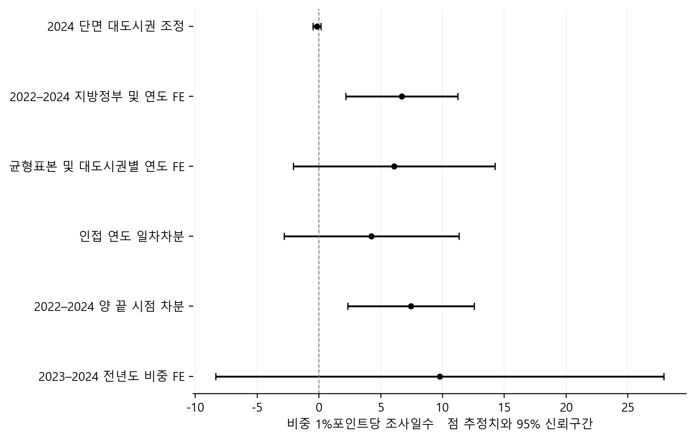

# 이주배경 인구구성과 아동보호 행정의 조사기간

## 스웨덴 51개 대도시권 지방정부의 공개자료 분석과 정책적 함의

연구논문 개정 초안 · 2026년 11월 13일

### 국문초록

본 연구는 스웨덴 51개 대도시권 지방정부에서 이주배경 인구구성과 아동·청소년 사회복지 조사기간의 관계를 분석한다. SCB의 공식 지역분류를 검증하고 Kolada의 2022–2025년 평균 조사기간과 SCB의 연령·부모 출생배경별 인구를 결합하였다. 2024년 결과변수는 44개 지방정부에서 관측되었으며 평균은 100.70일이었다. 대도시권 고정효과를 포함한 단면 추정에서는 네 인구구성 지표와 조사기간 사이에 정밀한 선형 관계가 확인되지 않았다. 반면 지방정부·연도 고정효과 패널에서 스웨덴 출생 아동 중 부모가 모두 해외 출생인 비중의 계수는 1%포인트당 6.70일이었다. 이 계수는 모든 단일 지방정부 제외에서 양수였으나, 영향력이 큰 세 지방정부를 함께 제외하면 3.21일로 낮아지고 불확실성이 커졌다. 인접 연도 일차차분은 정밀하지 않았지만 2022–2024년 양 끝 시점 차분은 양의 관계를 보였다. 따라서 지역 내 변화에서 나타나는 신호를 하나의 관측 오류로 환원할 수는 없지만, 보편적인 행정 지연이나 인과효과로 일반화하기도 어렵다. 정책적으로는 인구배경 비중만으로 지역을 평가하기보다 조사 처리, 긴급지원 개시, 실제 보호·교육 도달을 나누어 기록하고 사례 부담과 보고체계를 함께 점검할 필요가 있다.

주제어: 스웨덴, 이주배경, 아동보호, 사회복지 조사기간, 지방정부, 행정역량

JEL 분류: I38, J15, C23

---

# 1 서론

아동보호 정책의 성과는 권리가 법률에 규정되어 있는지뿐 아니라 그 권리가 어떤 행정 경로를 거쳐 실현되는지에 달려 있다. 스웨덴의 2024년 보호시설 제도 개편은 보호자와 동반한 아동의 개별적인 필요 판단과 지원 책임을 강화하였다[1, 2]. 그러나 법적 권리의 확대, 지방정부의 절차 보유, 사회복지 조사의 종료, 실제 보호와 교육의 시작은 서로 다른 결과다. 이주배경 주민이 많은 지역에서 행정 대응이 느린지를 묻기 위해서도 우선 어느 단계를 관측하는지 구분해야 한다.

이 연구는 조사 착수부터 종료까지의 평균 일수에 초점을 맞춘다. 분석 대상은 스톡홀름·예테보리·말뫼 대도시권을 구성하는 51개 지방정부다. 전체 주민의 해외 출생 비중과 아동의 부모 출생배경을 구별하고, 2024년의 지역 간 차이와 2022–2025년의 지역 내 변화를 별도로 추정한다. 이러한 구분은 서로 다른 인구구성 지표를 모두 ‘이주민 비중’으로 부르거나 한 시점의 지역 비교를 정책 변화의 효과로 해석하는 오류를 줄인다.

분석의 핵심 결과는 단면과 패널의 차이에 있다. 2024년 지역 간 비교에서는 인구구성 지표와 조사기간 사이의 선형 관계가 작고 정밀하지 않다. 같은 지방정부의 시간 변화에서는 일부 아동 배경지표가 양의 관계를 보인다. 다만 이 결과는 관측기간, 보고 표본과 영향력이 큰 지역에 민감하다. 이 연구는 가장 큰 계수만을 선택하는 대신 지방정부 및 개별 연도 관측치 제외, 균형패널, 대도시권별 연도 효과와 일차차분을 함께 제시한다.

정책적 질문은 두 가지다. 첫째, 공개 집계자료가 이주배경 인구가 많은 지역의 행정 부담을 어느 정도 설명하는가. 둘째, 현재의 통계가 실제 아동의 보호 접근을 평가하기에 충분한가. 첫 질문에는 제한적인 지역 수준의 증거를 제시할 수 있으나, 두 번째 질문에는 추가적인 사건일 자료가 필요하다. 본고는 이러한 증거의 범위를 정책 설계의 출발점으로 삼는다.

# 2 제도적 배경과 분석틀

## 2.1 보호시설 개편과 아동의 독립적인 권리

2024년 4월 1일부터 시행된 스웨덴의 제도 개편은 보호시설을 이용하는 동반 아동을 독립적인 지원 대상으로 다루도록 하였다. 정부와 사회보건청의 설명에 따르면 아동의 필요를 개별적으로 판단하고 별도의 지원 결정을 내리며, 학교와 보건서비스에 대한 접근도 강화하는 것이 개편의 취지다[1, 2]. 이는 본 연구의 제도적 배경이지만, 분석한 평균 조사기간 자체가 이 개편의 이행 정도를 직접 측정하는 지표는 아니다.

전국적으로 적용된 법률의 전후에 조사기간이 달라졌다는 이유만으로 법률의 효과를 추정했다고 볼 수 없다. 개편에 노출되지 않은 적절한 비교집단이 없고, 현재 자료는 법률의 대상 사건과 일반 아동·청소년 조사를 분리하지 못한다. 따라서 2024년을 처치 시점으로 삼은 차이의 차이 추정을 수행하지 않는다. 본고가 사용하는 제도 변화의 정보는 측정 대상과 정책 관심의 관계를 명확히 하는 역할을 한다.

## 2.2 인구구성과 행정 부담의 가능한 경로

해외 출생 주민이나 이주배경 아동의 비중은 언어지원 수요, 지역의 사례 구성 및 서비스 접근 조건과 관련될 수 있다. 통역과 기관 간 정보 전달에 추가적인 조정이 필요하거나, 인구 유입 속도에 비해 담당 인력이 충분히 늘지 않았다면 조사기간이 길어질 수 있다는 가설을 세울 수 있다. 반대로 기존의 다언어 서비스와 전문 인력이 축적된 지방정부에서는 인구구성과 조사기간의 관계가 약할 수 있다. 이 경로들은 검증할 가설이며 현재의 추정 계수만으로 확인한 기제가 아니다.

특히 부모 출생배경은 국적, 체류자격, 사용 언어 또는 복지기관 이용 경험과 동일하지 않다. 해외 출생 아동과 스웨덴 출생 아동을 구분하고 후자를 부모의 출생지 조합으로 나누더라도, 개별 아동의 위험도나 언어지원 필요는 여전히 관측되지 않는다. 같은 비중을 가진 지방정부도 사례 수, 인력, 조직과 주거 이동의 양상이 다를 수 있다.

## 2.3 조사기간과 실제 보호 도달의 구분

선행 통합 원고는 행정절차 보유, 사건 조사, 실제 보호 도달을 구분하였다[11]. 본고는 이 구분을 받아들이되, 그 원고에 보고된 VIND28 및 스톡홀름 구역별 추정치를 이번 51개 지방정부 자료의 결과로 통합하지 않는다. 본고의 실증적 증거는 별도로 확보하고 검증한 SCB·Kolada 자료에서 산출하였다.

조사 종료까지 걸린 기간이 곧 긴급지원 개시까지의 대기기간은 아니다. 평균 조사기간이 짧아도 일부 사건이 장기화되거나 특정 집단의 접근이 어려울 수 있다. 반대로 위험과 지원 필요를 충분히 파악하는 과정에서 조사기간이 길어질 수도 있다. 따라서 본고는 ‘사회복지 조사기간’이라는 명칭을 일관되게 사용하며 이를 가정폭력 피해 아동의 시설 입소 지연으로 바꾸어 해석하지 않는다.

# 3 자료와 변수의 정의

## 3.1 분석 지역과 공식 자료의 결합

SCB의 대도시권 분류에 따르면 스톡홀름은 26개, 예테보리는 13개, 말뫼는 12개 지방정부로 구성된다[5]. 공식 집계 분류의 구성원 코드를 추출하고 지방정부 명칭을 Kolada와 대조하였다. 모든 코드는 앞자리 0을 포함한 네 자리 문자로 보존하였다. 본고에서 ‘지방정부’는 kommun을 뜻하며 스톡홀름시 내부 구역과 구별된다.

Kolada의 실시간 API 명세를 확인한 뒤 지표 정의와 연도별 응답을 저장하였고, SCB에서는 UtlSvBakgFin 또는 TAB4824 표의 메타데이터와 선택 자료를 내려받았다[3, 4]. 2015년과 2022–2024년의 51개 지방정부, 네 배경 범주, 18개 단일 연령, 두 성별에 해당하는 29,376개 계수값은 공식 벌크 CSV와 전부 일치하였다. 요청 URL·시각·오류 및 파일 해시를 보존하여 자료 취득과 변환을 추적할 수 있도록 하였다.

<표 1> 자료의 측정 대상과 해석 범위

| 자료와 지표 | 단위와 기간 | 관측 내용과 한계 |
| --- | --- | --- |
| Kolada U33401 | 지방정부·연도 2022–2025 | 상반기 0–20세 사회복지 조사 평균 일수. 개인의 보호·입소 대기기간 아님 |
| Kolada N02926 | 지방정부·연도 2015, 2022–2025 | 연말 전체 주민 중 해외 출생 비중. 사건 표본의 구성 아님 |
| SCB TAB4824 | 지방정부·연령·성별 2015, 2022–2024 | 0–17세 아동의 출생지와 부모 출생배경. 2025년 값 없음 |
| SCB 대도시권 분류 | 51개 지방정부 | 스톡홀름 26, 예테보리 13, 말뫼 12. 시 내부 구역과 구분 |

주: 출처: Kolada 지표 메타데이터, SCB TAB4824 및 공식 대도시권 집계 분류[3–5].

## 3.2 결과변수와 보고 범위

결과변수 U33401은 사회복지 조사가 시작된 때부터 끝날 때까지의 평균 일수다. 현재 메타데이터에서 대상 연령은 0–20세이고 측정기간은 상반기다. 경제적 지원, 가족법 및 친자확인 조사는 제외된다. 지방정부 자체조사를 자료원으로 하며 가을까지 수집이 이어지므로 연말 이전 비교에 주의를 요구한다[3]. 성별 전체값 T를 사용하며 남녀 평균을 임의로 다시 평균하지 않았다.

2022–2025년의 결과변수 관측 지방정부 수는 각각 42개, 42개, 44개, 41개다. 51개 지방정부와 네 연도의 결합틀은 204행이지만, 이는 모두 관측된 204개 결과값을 뜻하지 않는다. 자료가 없는 칸은 결측으로 남겼으며 0일이나 이전 연도의 값으로 대체하지 않았다. API의 count 필드는 보고 단위 수이므로 이를 조사 사건 수 또는 회귀 가중치로 사용하지 않았다.

<표 2> 연도별 평균 조사기간의 관측 범위

| 연도 | 스톡홀름 | 예테보리 | 말뫼 | 51개 전체 | 전국 |
| --- | --- | --- | --- | --- | --- |
| 2022 | 21/26 | 10/13 | 11/12 | 42/51 | 216/290 |
| 2023 | 20/26 | 10/13 | 12/12 | 42/51 | 206/290 |
| 2024 | 22/26 | 11/13 | 11/12 | 44/51 | 195/290 |
| 2025 | 22/26 | 10/13 | 9/12 | 41/51 | 177/290 |

주: 각 셀은 관측 지방정부 수/해당 집단 전체 수다. 미관측은 0일이나 조사 미실시를 뜻하지 않는다. 출처: 공식 Kolada 응답의 직접 집계.

RKA는 2025년부터 입력 포털 대신 제출 양식을 받아 게시하는 방식으로 보고 절차를 바꾸었다. 공식 변경 문서는 평균 조사기간 U33401의 2025년 수집을 유지하되 중앙값 U33402의 수집을 중단한 것으로 제시한다[6]. 다만 연도별 설문 원본과 정의 개정 이력 전체는 확보하지 못했으므로 2022–2025년의 현장 적용이 완전히 동일했다고 단정하지 않는다. 이러한 불확실성은 특히 짧은 패널의 변화 해석에서 중요하다.

## 3.3 해외 출생 비중과 아동의 부모 출생배경

Kolada N02926은 해당 연도 12월 31일 전체 주민 중 해외 출생자가 차지하는 백분율이다. 분모는 전 연령의 전체 주민이며 조사를 받은 아동의 수가 아니다[3]. 2015년 값을 사전 지역구성 지표로, 2024년 값을 동시점 비교지표로 사용한다. 패널에서는 실제 연도별로 관측한 2022–2025년 값을 사용한다. SCB가 2025년 인구통계부터 도입한 공개자료의 비밀보호 처리는 별도의 측정 변화로 고려하고, 2025년을 제외한 민감도도 확인하였다.

아동 배경은 SCB가 제시하는 네 범주로 나눈다. A는 해외 출생, B는 스웨덴 출생·부모 모두 해외 출생, C는 스웨덴 출생·한 부모만 해외 출생, D는 스웨덴 출생·부모 모두 스웨덴 출생이다. 각 범주에서 단일 연령 0세부터 17세까지와 두 성별을 합산하였다. 이는 36개 셀의 합이며 0–19세 등 다른 연령대의 합으로 대체하지 않았다[4].

<표 3> SCB의 아동 출생배경 네 범주

| 기호·코드 | 공식 스웨덴어 범주명 | 한국어 정의 |
| --- | --- | --- |
| A · 08 | utrikes födda | 해외 출생 아동 |
| B · 4 | inrikes födda med två utrikes födda föräldrar | 스웨덴 출생 양부모 해외 출생 |
| C · 5 | inrikes födda med en inrikes och en utrikes född förälder | 스웨덴 출생 한 부모만 해외 출생 |
| D · 6 | inrikes födda med två inrikes födda föräldrar | 스웨덴 출생 양부모 스웨덴 출생 |

주: 출처: SCB TAB4824 실시간 메타데이터[4]. 모든 범주에서 만 0–17세와 두 성별을 합산한다. A의 분류에는 부모의 출생지를 별도로 적용하지 않는다.

F_it = 100 × (A+B)/(A+B+C+D)

P_it = 100 × (B+C)/(B+C+D)

Q_it = 100 × B/(B+C+D)

첫 번째 지표의 분모는 전체 아동이고 두 번째와 세 번째의 분모는 스웨덴 출생 아동이다. 해외 출생 아동 A는 부모의 출생지와 관계없이 해외 출생 범주에 속한다. 따라서 세 지표는 서로 다른 질문에 답한다. 분자와 분모를 모두 보존하여 비율의 변화가 아동 수의 어느 구성요소에서 나타나는지 후속 분석할 수 있도록 하였다.

TAB4824는 2024년까지의 자료를 제공하므로 2025년 아동 배경비중은 생성하지 않았다. 이 때문에 아동 배경지표의 패널은 2022–2024년에 한정된다. 또한 인구구성은 연말 시점의 재고량이고 결과변수는 상반기의 조사기간이다. 동시 연도라는 이유만으로 인구구성이 조사기간보다 먼저 결정되었다고 가정하지 않는다.

# 4 추정 대상과 통계적 방법

## 4.1 2024년 단면의 지역 간 관계

2024년의 기본 모형은 평균 조사기간을 각 인구구성 지표 하나와 대도시권 지시변수에 회귀한다. 노출변수 X는 백분율로 환산하므로 계수의 단위는 비중 1%포인트당 조사일수다. 2015년과 2024년의 네 지표를 각각 추정하며, 서로 강하게 관련될 수 있는 비중을 모두 한 식에 넣어 개별 효과를 주장하지 않는다. HC3 이분산강건 표준오차와 잔차 자유도의 t 기준 신뢰구간을 사용하였다.

Y_i,2024 = α + β X_i,2024 + γ_m(i) + ε_i

Pearson·Spearman 상관계수와 대도시권을 조정한 부분상관도 계산하였다. 기본 회귀는 지방정부별 동일 가중치를 사용한다. 사건 수 분모가 없으므로 사건 수준 평균을 복원할 수 없으며, 아동 인구를 이용한 가중 회귀는 다른 가중 대상을 보는 민감도로만 취급한다. 사전 등록된 확증 검정이 아니므로 여러 추정 중 하나의 p값에 결론을 의존하지 않는다.

## 4.2 지방정부와 연도 고정효과 패널

패널 모형의 지방정부 고정효과는 시간에 따라 변하지 않는 지역 특성을, 연도 고정효과는 공통적인 연도별 변화를 제거한다. 따라서 패널 계수는 높은 비중을 가진 지역과 낮은 비중을 가진 지역의 차이보다, 같은 지역에서 인구구성과 조사기간이 어떻게 함께 변했는지에 근거한다. 이 추정 대상은 단면의 지역 간 관계와 같지 않다.

Y_it = α_i + λ_t + β X_it + ε_it

표준오차는 지방정부 단위로 군집화하고 유한표본 보정을 적용하였다. 신뢰구간에는 지방정부 수에서 1을 뺀 자유도의 t 분포를 사용하였다. 완전 관측이 한 번뿐인 지방정부는 지역 내 기울기를 식별하지 못하므로 제외하였다. 2015년 비중은 시간 불변이므로 이 모형에 별도 설명변수로 넣지 않았다. 기본 패널의 네 기울기와 기본 단면의 여덟 기울기는 서로 다른 검정군으로 구분해 Benjamini–Hochberg 보정값을 함께 보고하였다.

민감도는 각 분석기간에 결과가 모두 관측된 균형패널과 대도시권별 연도 효과를 사용하였다. 후자는 같은 대도시권에 속한 지방정부가 공유하는 연도별 충격을 허용한다. 대도시권이 세 곳뿐이므로 대도시권 단위의 통상적 군집 추론은 사용하지 않았다. 지방정부 군집화 역시 공간적으로 연결된 서로 다른 지방정부의 공통 충격을 완전히 처리하지는 못한다.

## 4.3 영향력 진단과 일차차분

각 지방정부를 하나씩 제외하고 고정효과와 표준오차를 다시 추정하였다. 개별 지방정부·연도 셀 제외와 영향력이 큰 관측치들의 동시 제외도 수행하였다. 이러한 제외는 추정 결과가 특정 지역에 얼마나 의존하는지를 알아보는 스트레스 테스트다. 진단 이후 선택한 집단을 제외한 p값은 표본을 사전에 정해 얻은 확인적 검정으로 해석할 수 없다.

ΔY_it = δ_t + β ΔX_it + Δε_it

일차차분은 실제로 관측된 연속 연도 사이의 변화만 사용하였다. 2023년이 결측인 지역의 2022–2024년 변화를 1년 차분으로 취급하지 않았다. 인접 연도 차분을 합칠 때에는 공통 구간 효과를 두고 지방정부 군집 표준오차를 사용하였다. 별도로 2022년과 2024년이 모두 관측된 지역의 양 끝 시점 차분을 추정하고 HC3 표준오차를 사용하였다. 세 시점 수준 모형, 연간 차분과 두 시점 차분은 변화에 부여하는 가중치와 오차구조가 달라 같은 추정량이 아니다.

# 5 2024년 단면에서 관찰되는 지역 차이

2024년 관측된 44개 지방정부의 조사기간 평균은 100.70일, 표준편차는 13.48일이었다. 관측 지방정부의 단순 평균은 스톡홀름 대도시권 103.43일, 예테보리 92.00일, 말뫼 103.95일이다. 이는 사건 수로 가중된 대도시권 전체 평균이 아니다. 특히 예테보리시는 해당 연도 결과변수가 관측되지 않아 예테보리 대도시권 평균을 예테보리시의 성과로 읽을 수 없다.

<표 4> 2024년 평균 조사기간의 지역별 분포

| 대도시권 | 관측/전체 | 평균 일수 | 표준편차 | 최솟값 | 최댓값 |
| --- | --- | --- | --- | --- | --- |
| 스톡홀름 | 22/26 | 103.43 | 13.47 | 86 | 137 |
| 예테보리 | 11/13 | 92.00 | 12.80 | 67 | 112 |
| 말뫼 | 11/12 | 103.95 | 11.21 | 75 | 117 |
| 전체 | 44/51 | 100.70 | 13.48 | 67 | 137 |

주: 관측 지방정부별 동일 가중치 통계다. 사건 수 가중 평균이 아니다. 예테보리시의 2024년 값은 미관측이다. 출처: 본고 계산.

네 동시점 인구구성 지표의 원 Pearson 상관계수는 약 0.015–0.052로 작았다. 대도시권을 조정하면 기울기는 모두 작은 음수였으나 신뢰구간은 0을 포함하였다. 예컨대 전체 주민의 해외 출생 비중에 대한 계수는 −0.216일, 95% 신뢰구간은 [−0.673, 0.241]일이다. 스웨덴 출생 아동 중 양부모 해외 출생 비중의 계수는 −0.160일이었다. 2015년 비중을 사용한 네 회귀도 같은 결론을 바꾸지 않았다.

<표 5> 2024년 대도시권 고정효과 단면 회귀

| 인구구성 지표 | 계수 | 95% 구간 | p값 |
| --- | --- | --- | --- |
| 전체 주민 해외 출생 | -0.216 | [-0.67, 0.24] | .346 |
| 전체 아동 해외배경 | -0.163 | [-0.47, 0.15] | .295 |
| 스웨덴 출생 아동 한 명 이상 해외 출생 부모 | -0.123 | [-0.42, 0.17] | .404 |
| 스웨덴 출생 아동 양부모 해외 출생 | -0.160 | [-0.48, 0.16] | .325 |

주: 각 지표를 별도 추정했다. 모든 모형 n=44, HC3 표준오차와 t(n−k) 구간. 단위는 비중 1%포인트당 일수. 2015년 네 지표를 포함한 기본 단면 8개 검정의 BH 보정값은 모두 약 .419였다.

이 결과는 두 의미를 구분해야 한다. 현재 표본에서 지역 인구구성과 조사기간의 정밀한 단면 관계를 확인하지 못했다는 뜻이지만, 관계가 정확히 0이거나 서비스 접근이 평등하다는 뜻은 아니다. 2024년 결과가 없는 일곱 지방정부의 인구구성은 관측 지역과 다를 수 있다. 실제로 비관측 지역의 평균 해외 출생 비중은 더 높았으나, 일곱 곳이라는 작은 집단으로 결측의 원인을 확정할 수는 없다.

# 6 패널의 양의 관계와 해석의 차이

해외 출생 주민 비중의 기본 패널에는 45개 지방정부와 169개 관측치가, 아동 배경비중에는 43개 지방정부와 126개 관측치가 포함된다. 패널의 네 기울기는 모두 양수다. 전체 아동의 해외배경 비중은 1%포인트당 5.38일, 스웨덴 출생 아동의 양부모 해외 출생 비중은 6.70일로 추정되었다. 두 지표의 원 p값은 각각 .023과 .0048, 네 기본 패널 검정에 대한 보정값은 .046과 .019였다.

<표 6> 지방정부와 연도 고정효과의 기본 패널 추정

| 인구구성 지표 | n/G | 계수 | 95% 구간 | p값 |
| --- | --- | --- | --- | --- |
| 전체 주민 해외 출생 | 169/45 | 5.78 | [-0.92, 12.49] | .089 |
| 전체 아동 해외배경 | 126/43 | 5.38 | [0.78, 9.97] | .023 |
| 스웨덴 출생 아동 한 명 이상 해외 출생 부모 | 126/43 | 4.60 | [-0.94, 10.14] | .101 |
| 스웨덴 출생 아동 양부모 해외 출생 | 126/43 | 6.70 | [2.16, 11.23] | .005 |

주: G는 지방정부 수. 첫 행은 2022–2025년, 나머지는 2022–2024년이다. 지방정부 군집 표준오차, t(G−1) 구간. 단위는 1%포인트당 일수. 해외배경·양부모 해외 출생의 BH 보정 p값은 각각 .046, .019다.

단면의 작은 기울기와 패널의 양의 기울기는 논리적 모순이 아니다. 다른 지방정부보다 비중이 높은 지역에서 조사기간이 길지 않더라도, 같은 지방정부가 공통 연도 변화에 비해 비중과 조사기간의 동반 증가를 보일 수 있다. 지방정부 고정효과가 제거하는 것은 일정한 지역 차이이며, 새로 늘어난 사례 부담이나 인력 변동처럼 시간에 따라 바뀌는 요인은 남는다. 계수의 부호만으로 어떤 요인이 작동했는지는 식별하지 못한다.

표본 구성만으로 부호 차이가 생기는지도 확인하였다. 2022–2024년 결과가 모두 있는 동일한 40개 지방정부에서 양부모 해외 출생 비중의 단면 기울기는 −0.105일, 패널 기울기는 +6.555일이었다. 따라서 같은 지역을 사용해도 차이가 남는다. 다만 이 표본에서 지방정부와 연도 효과를 제거한 해당 비중의 잔차 표준편차는 약 0.27%포인트에 불과하다. 1%포인트당 큰 계수는 좁은 변화 범위에서 추정되었으므로 외삽과 측정 오차에 주의해야 한다.

<표 7> 양부모 해외 출생 비중의 패널 민감도

| 모형 | n/G | 계수 | 95% 구간 | p값 |
| --- | --- | --- | --- | --- |
| 기본 불균형패널 | 126/43 | 6.70 | [2.16, 11.23] | .005 |
| 균형패널 | 120/40 | 6.55 | [0.37, 12.74] | .038 |
| 대도시권별 연도 효과 | 126/43 | 6.52 | [0.10, 12.94] | .047 |
| 균형표본과 대도시권별 연도 효과 | 120/40 | 6.07 | [-2.09, 14.24] | .140 |

주: 모든 행은 2022–2024년이다. 지방정부 군집 표준오차와 유한표본 보정을 적용했다. 민감도 p값은 탐색적이며 다중검정 보정 전 값이다.

양부모 해외 출생 비중은 균형패널에서 +6.55일(p=.038), 대도시권별 연도 효과를 포함하면 +6.52일(p=.047)로 각각 추정되었다. 그러나 두 조건을 함께 적용하면 +6.07일, 95% 신뢰구간 [−2.09, 14.24]일, p=.140으로 불확실성이 커졌다. 전체 아동의 해외배경 비중에 대한 결과는 균형표본 또는 대도시권별 연도 효과를 적용한 경우 이미 정밀하지 않았다. 따라서 본고는 양의 점추정치가 남는다는 사실과 통계적 정밀성이 유지되는지를 나누어 평가한다.

## 6.1 군집 추론과 인구 측정시점의 추가 검증

지방정부 군집이 43개인 기본 패널의 추론을 보완하기 위해 귀무가설을 부과한 wild cluster bootstrap-t 검정을 추가하였다. 제한 모형의 잔차에 지방정부별로 동일한 Rademacher 부호를 부여하고, 9,999회마다 고정효과와 CR1 군집 표준오차를 다시 계산하였다. 난수 시드는 20261113으로 고정하였다. 양측 부트스트랩 p값은 .014였고 몬테카를로 표준오차는 약 .0012였다. 따라서 기본 모형의 양의 관계는 이 군집 추론 방식에서도 남는다. 이 검정도 시간가변 교란, 지역 간 오차 상관과 식별 정보의 집중을 해결하지 않는다.

인구 측정의 선후관계도 점검하였다. 상반기 조사기간보다 앞선 전년도 말의 부모배경 비중을 사용하고 2023–2024년의 실제 관측값만 연결한 지방정부·연도 고정효과 모형에서 계수는 +9.78일, 95% 신뢰구간은 [−8.35, 27.92]일이었다. 같은 41개 지방정부·82개 관측치에 동시점 비중을 사용하면 +5.19일, 신뢰구간 [−8.93, 19.31]일이었다. 두 모형 모두 정밀하지 않다. 분석기간이 두 시점으로 줄어드는 점을 함께 보아야 한다. 전년도 비중도 역인과와 누락변수를 해소하지 않는다. 추가 추정과 비교 그림은 부록 C에 제시한다.

# 7 어느 지방정부와 관측치가 결과를 지지하는가

## 7.1 지방정부별 영향력

기본 양부모 해외 출생 비중 모형에서 43개 지방정부를 각각 제외한 기울기는 모두 양수였고 범위는 5.64–7.17일이었다. 원 p값이 .05보다 작은 경우는 42회였다. 이는 한 지역을 제외하면 부호가 뒤집히는 형태의 결과는 아니라는 뜻이다. 그러나 Öckerö, Nynäshamn과 Upplands-Bro는 양의 계수를 지지하는 영향력이 컸으며, 이 세 곳을 함께 제외하면 계수는 3.21일로 낮아졌다.

<표 8> 양부모 해외 출생 비중의 지방정부 제외 진단

| 제외한 지방정부 | 재추정 계수 | p값 |
| --- | --- | --- |
| 제외 없음 | 6.70 | .0048 |
| Öckerö 1407 | 5.64 | .007 |
| Nynäshamn 0192 | 6.03 | .017 |
| Upplands-Bro 0139 | 6.04 | .057 |
| Staffanstorp 1230 | 6.11 | .012 |
| Burlöv 1231 | 6.37 | .008 |
| Öckerö·Nynäshamn·Upplands-Bro 동시 제외 | 3.21 | .263 |
| 상위 5개 지지 지방정부 동시 제외 | 1.10 | .690 |

주: 기본 지역·연도 고정효과 모형을 매번 재추정했다. 집단 제외 순위는 전체 표본의 단일 제외에서 계수를 가장 낮추는 순서로 정한 사후 스트레스 테스트다. 상위 5곳은 앞의 세 곳에 Staffanstorp와 Burlöv를 더한 집단이다.

세 지방정부의 기여는 지역·연도 효과를 제거한 설명변수와 결과변수의 교차곱에서 약 71.1%를 차지하였다. 이 수치는 부호를 가진 회귀 분자에 대한 기여이며 사건 수 비중이나 설명된 분산의 비율이 아니다. 단일 제외와 집단 제외를 모두 제시해야 하는 이유도 여기에 있다. Upplands-Bro를 제외한 점추정치는 여전히 +6.04일이지만 p=.057로 바뀌어, 통계적 유의 여부가 일부 지역의 정보량에 의존함을 보여준다.

## 7.2 개별 연도 관측치와 실제 변화

Öckerö의 2022년 조사기간은 140일이고 2024년은 112일이었다. 두 시점의 부모배경 비중은 거의 같지만 다른 지역들의 공통적인 비중 변화와 비교하면 지역·연도 조정 후 양의 공분산에 기여한다. Nynäshamn은 2022–2024년 비중이 약 2.26%포인트, 기간이 22일 늘었고, Upplands-Bro는 각각 3.33%포인트와 25일 늘었다. Staffanstorp에서는 비중이 0.98%포인트 증가하는 동안 기간이 65일에서 117일로 늘었다.

Öckerö의 2022년 값과 Tjörn의 2024년 값을 함께 제외하면 기본 계수는 +4.81일, p=.069였다. Nynäshamn의 2022년까지 제외하면 +3.99일, p=.164였다. 단일 셀 제외에서도 계수의 부호는 모두 양수였지만 소수 셀의 결합은 정밀성을 약화시켰다. 이 값들은 공식 자료의 관측값이며, 영향력이 크다는 사실을 자료 오류의 증거로 취급하지 않았다.

Upplands-Bro는 2022년과 2024년 결과만 있다. 두 셀 중 하나를 제외하면 남은 한 번의 관측은 지역 내 변화에 기여하지 못하므로 고정효과 분석에서 함께 제외된다. 따라서 해당 셀 제외는 실질적으로 지방정부 전체 제외와 같으며, 다른 지역의 순수한 한 셀 제외와 구분해야 한다.

## 7.3 일차차분이 보여주는 기간 의존성

실제로 연속 연도가 연결되는 42개 지방정부의 82개 연간 변화에서 추정한 계수는 +4.25일, 95% 신뢰구간 [−2.83, 11.33]일, p=.232였다. 대도시권별 구간 효과를 허용하면 +4.06일(p=.333)이었다. 40개 완전 관측 지방정부에 한정한 연간 차분도 정밀하지 않았다. 2022–2023년과 2023–2024년을 따로 추정한 경우에도 각각의 신뢰구간이 0을 포함하였다.

<표 9> 양부모 해외 출생 비중의 일차차분 추정

| 모형 | 변화/G | 계수 | 95% 구간 | p값 |
| --- | --- | --- | --- | --- |
| 인접 연도 차분 | 82/42 | 4.25 | [-2.83, 11.33] | .232 |
| 인접 연도와 대도시권별 구간 효과 | 82/42 | 4.06 | [-4.32, 12.45] | .333 |
| 2022–2024년 차분 | 41/41 | 7.74 | [4.42, 11.07] | <.001 |
| 2022–2024년 차분과 대도시권 조정 | 41/41 | 7.43 | [2.31, 12.55] | .006 |

주: 연간 차분에는 실제 연속 관측만 사용하며 구간 효과를 포함한다. 연간 차분은 지방정부 군집, 양 끝 시점 차분은 HC3 표준오차를 사용했다. 비중 1%포인트당 일수이며 두 시점 차분을 1년 변화로 간주하지 않았다.

반면 2022년과 2024년 양 끝 시점의 변화는 41개 지방정부에서 +7.74일로 추정되었고, 대도시권을 조정한 결과는 +7.43일, 95% 신뢰구간 [2.31, 12.55]일, p=.0056이었다. 후자의 계수는 41개 지방정부를 각각 제외해도 모두 양수이며 원 p값은 .05보다 작았다. 따라서 두 시점 차분의 관계를 하나의 지방정부만으로 설명할 수는 없다.

다만 대도시권 조정 양 끝 시점 차분에서 영향력이 가장 큰 Staffanstorp, Österåker와 Nynäshamn을 함께 제외하면 +4.64일(p=.082)로 정밀성이 낮아졌다. 인접 연도 차분과 양 끝 시점 차분은 중간 연도의 단기 변동을 다르게 반영한다. Upplands-Bro는 2023년이 없어 연간 차분에는 포함되지 않지만, 균형표본에서도 연간 차분이 정밀하지 않다는 점에서 표본 차이만이 전부는 아니다. 이 결과는 연간 관계의 일관성보다 2022–2024년 누적 변화에서 더 강한 신호가 있음을 보여준다.

## 7.4 비율 변화의 분자와 분모를 구분한다

양부모 해외 출생 비중 Q의 상승은 해당 아동 수 B의 증가와 전체 스웨덴 출생 아동 수 S의 변화가 함께 만든다. 2022–2024년의 변화를 정확히 분해하면 ΔQ=100×평균(1/S)×ΔB + 100×평균(B)×Δ(1/S)이다. 평균은 두 시점의 산술평균이며 두 항의 합은 관측된 비중 변화와 일치한다. 이는 회계적 분해로서 출생, 연령 이동, 유입·유출의 원인을 식별하는 인과분해가 아니다.

Upplands-Bro에서는 B가 2,304명에서 2,597명으로, S가 6,784명에서 6,964명으로 늘었다. 비중 증가 3.33%포인트는 분자 변화 +4.26%포인트와 분모 변화 −0.93%포인트의 합이다. Nynäshamn의 +2.26%포인트 역시 +2.77과 −0.52로 나뉜다. 두 지역의 비중 상승을 분모 감소만으로 설명할 수는 없다. 반면 Öckerö의 비중은 양 끝 시점에서 약 −0.026%포인트 변하는 데 그쳤다. 이 지역의 패널 영향력은 두 시점 순증보다 2023년을 포함한 경로와 조사기간 변화에 의존한다. 따라서 영향력이 큰 지방정부가 모두 같은 인구 변화 경로를 보인다고 해석해서는 안 된다. 51개 지방정부의 분자·분모와 정확한 분해값을 별도 CSV로 제공한다.

# 8 도구변수 설계의 가능성과 제약

역사적 난민 분산배치나 출신국별 유입 충격을 이용한 도구변수는 후속 연구의 후보가 될 수 있다. 스웨덴의 과거 난민 배치정책에 관한 연구는 초기 거주지 배정의 제도적 특성과 주택 공급 조건의 중요성을 설명한다[7]. 그러나 수십 년 전 배치가 현재의 인구구성을 예측한다고 해도, 주거분리나 장기적인 행정조직을 통해 조사기간에 직접 영향을 미칠 가능성이 있다. 현재의 해외 출생 비중을 설명하는 관련성과 배제제약은 별도로 평가해야 한다.

출신국별 기초 거주 분포와 전국 유입을 결합하는 시프트셰어(shift-share) 방식도 기초 분포, 충격의 외생성 및 공통 노출에 맞는 추론을 요구한다[8–10]. TAB4824의 네 배경 범주는 출신국별 노출 자료가 아니므로 이 표만으로 적절한 도구를 만들 수 없다. 특히 유입 충격이 스웨덴 출생 아동의 부모배경 비중을 어떤 경로로 바꾸는지에는 출생, 연령 이동과 가구 이동을 고려한 별도의 1단계 논리가 필요하다.

본 연구에서는 정당화된 도구변수를 확보하지 못했으므로 2단계 최소제곱을 수행하지 않았다. 따라서 1단계 계수나 약한 도구 진단 수치를 보고하지 않는다. 후속 연구에서는 실제 초기 배치 기록, 역사적 경계 대응표와 출신국별 자료를 확보한 뒤 동일 표본·통제변수에서 부분 설명력과 적절한 강도 진단, 약한 도구에 강건한 신뢰집합을 보고해야 한다. 2015년 비중은 오래된 값이라는 이유만으로 유효한 도구가 되지 않는다.

# 9 정책적 함의

## 9.1 인구배경 비중에 근거한 지역 낙인을 피한다

이번 결과만으로 이주배경 인구가 많은 지방정부를 일률적으로 ‘느린 지역’으로 분류하는 것은 적절하지 않다. 단면 관계는 작고, 지역 내 변화의 양의 관계도 일부 지역과 기간에 민감하다. 이주배경 자체를 행정 부진의 원인으로 간주하기보다 실제 사례 부담과 업무 조건을 관찰해야 한다. 반대로 정밀하지 않은 계수를 근거로 언어·정보 접근 장벽이 없다고 판단해서도 안 된다.

자원 배분에서는 담당자당 진행 사례 수, 위험도 구성, 통역 요청과 제공 간격, 결원·이직 및 기관 간 이관을 함께 점검할 것을 제안한다. 이 항목들은 본 연구에서 이미 효과를 입증한 결정요인이 아니라 다음 단계에서 수집하고 검증할 관리 변수다. 이주배경 비중만을 기준으로 인력 규모나 예산 가산율을 산정할 수 있는 수치는 현재 추정치에서 얻을 수 없다.

## 9.2 조사 처리와 보호 도달을 별도로 관리한다

정책 대시보드에는 조사 개시일·종료일 외에 최초 지원 요청일, 긴급 위험평가일, 실제 지원 개시일, 보호시설 배치일과 교육 재개일을 구분해 기록할 필요가 있다. 보호시설을 이용하지 않는 사례에는 배치일이 적용되지 않으므로 모든 사건에 같은 완료 기준을 강제해서는 안 된다. 필요한 지원이 시작되었는지와 조사 서류가 종료되었는지를 나누어 보아야 행정 속도 지표의 왜곡을 줄일 수 있다.

평균 하나만 공개하면 장기간 미종결된 사건이나 지원에 도달하지 못한 사건을 놓칠 수 있다. 사례 수 분모와 관측 종료 시점을 함께 공개하고 중앙값, 상위 분위수, 미종결 사례의 기간을 별도 산출할 것을 제안한다. 이는 평균 기간을 낮추기 위해 조사 종결을 서두르는 유인을 줄이고, 적시성과 판단의 충실성을 함께 평가하기 위한 방향이다.

## 9.3 보고 품질을 행정 성과와 분리한다

결과변수 미관측은 서비스 미제공이나 조사 미실시를 뜻하지 않는다. 지방정부별 보고 누락, 지표 정의의 현장 적용, 시스템 변경과 집계 대상 차이를 기록하는 품질 정보를 마련할 필요가 있다. 전국 단위 관측 지방정부 수가 감소하는 동안 대도시권 표본의 관측률은 다른 양상을 보였다는 사실도, 특정 지역집단의 변화와 전체 보고체계의 변화를 분리할 필요를 보여준다.

영향력이 큰 지역에 대해서는 실패 순위를 공표하기보다 수치 변화의 배경을 함께 검토하는 절차가 적절하다. Staffanstorp의 큰 기간 변화나 Upplands-Bro의 중간 연도 결측은 인력·사례 구성·보고 범위를 확인할 조사 대상이다. 그러나 현재 자료로 어느 원인이 실제로 작동했다고 판단하거나 해당 지방정부의 담당자에게 책임을 귀속할 수는 없다.

<표 10> 정책 제안과 평가를 위한 관측 항목

| 관리 과제 | 운영 방향 | 후속 평가 항목 |
| --- | --- | --- |
| 절차와 도달의 분리 | 조사와 실제 지원의 시점을 별도 기록 | 요청·위험평가·지원 개시·배치·교육 재개일 |
| 사례 부담과 인력 | 인구비중 단독 기준 대신 현장 수요 점검 | 진행 사례/담당자, 위험도, 통역, 결원·이직 |
| 보고 품질 | 미관측과 서비스 미제공을 구분 | 누락 사유, 시스템 변경, 정의 적용 이력 |
| 개입 평가 | 시범 도입 전 평가설계와 비교 가능성 검토 | 시행일, 대상 기준, 미종결·이탈, 접근권한 |

주: 본고의 정책 제안이다. 각 항목의 효과나 비용 절감은 이번 집계자료로 추정하지 않았다.

## 9.4 후속 평가를 위한 사건 자료를 설계한다

개인 수준의 격차를 평가하려면 동일한 사건 모집단에서 부모·아동의 배경과 절차별 날짜를 연결해야 한다. 이때 출생배경과 지원 필요를 동일시하지 않고, 필요한 범위에서 언어·체류기간·가구 상황과 사건의 긴급도를 별도로 수집해야 한다. 가명처리와 접근권한 제한, 소규모 셀의 공개 통제는 이러한 연구를 위한 운영 원칙으로 제안한다.

새로운 통역 조정이나 기관 간 인계 방식을 도입한다면 시행 시기와 대상 기준을 사전에 기록하고, 실제 비교 가능한 집단이 있는지부터 평가해야 한다. 제도 도입 전에 완료된 사건과 진행 중 사건을 구분하며 미종결 및 이탈도 분석 대상으로 남겨야 한다. 지금의 패널 계수는 이러한 개입의 예상 효과나 비용 절감액으로 사용하지 않는다.

## 9.5 시범사업의 평가 규칙을 도입 전에 정한다

실행 순서는 먼저 사건일과 사례 수의 기록을 정비하고, 그다음 통역 배정이나 기관 간 인계를 개선하는 제한된 시범사업을 평가하는 것이다. 시행일, 적용 기준과 비교집단을 사전에 확정한다. 가능하면 무작위 순차 도입을 검토하고, 행정적으로 시행 순서를 정했다면 비교 가능성과 도입 전 추세를 확인한다. 이번 집계자료의 결과만으로 시범지역의 수, 예산 또는 효과크기를 정하지 않는다.

평가의 일차 결과는 해당 개입이 직접 바꾸려는 단계에 맞추어 사전 지정한다. 통역 배정 개입이라면 요청부터 최초 통역 제공까지의 기간을, 보호 연계 개입이라면 적격 결정부터 실제 지원 개시까지의 기간을 측정한다. 안전상 필요한 긴급지원은 배정과 무관하게 제공한다. 평균 조사기간은 보조 결과로 두고 미종결 사례, 재개 조사와 판단 품질을 함께 확인하여 빠른 종결만을 보상하지 않도록 한다. 종료 기준과 분석 계획을 고정한 뒤 효과·불확실성·업무 부담을 보고하고 확대 여부를 판단한다. 이는 본 연구가 효과를 입증한 정책이 아니라, 현재의 증거 한계를 보완하기 위한 평가 설계 제안이다.

# 10 한계와 후속 연구

첫째, 분석 지역은 대도시권의 51개 지방정부이며 전국의 소규모·농촌 지방정부로 일반화하기 어렵다. 둘째, 보고된 평균 조사기간의 대상 사건 수가 없어 조사 건수 가중 평균이나 사건 수준 분포를 재구성할 수 없다. 셋째, 현행 지표의 정의는 확인하였으나 모든 연도의 설문 원본과 현장 측정동등성을 인증한 것은 아니다. 2025년 보고 절차 변화와 인구 공개자료의 비밀보호 변화도 비교에 영향을 줄 수 있다.

넷째, 아동 배경지표의 변화는 세 해에 한정되고 지역 내 변동이 작다. 지방정부 고정효과는 고정된 교란만 제거하며, 공통 연도 효과나 대도시권별 연도 효과도 개별 지역의 시간가변 요인을 모두 통제하지 못한다. 영향력 진단과 여러 민감도의 원 p값은 탐색적인 참고값이며 사후 선택을 반영한 확인적 검정이 아니다. 비유의한 결과를 동일성의 증거로 해석하지 않는다.

다섯째, 지역 전체의 인구배경은 실제 조사 대상 아동의 배경과 다르다. 이주배경 아동의 개별 대기기간이나 차별적 처리 여부를 판정하려면 해당 집단의 사건 수와 단계별 날짜가 필요하다. 특히 부모배경 비중의 분모가 스웨덴 출생 아동이라는 사실을 전체 아동 또는 보호시설 이용 아동의 구성으로 바꿀 수 없다. 이러한 생태학적 한계는 회귀의 통계적 유의성과 관계없이 남는다.

---

# 11 결론

스웨덴 51개 대도시권 지방정부의 공식 자료를 결합한 결과, 2024년 지역 간 인구구성과 평균 조사기간 사이에는 정밀한 선형 관계가 확인되지 않았다. 같은 지역의 시간 변화에서는 스웨덴 출생 아동 중 양부모 해외 출생 비중이 양의 관계를 보였지만, 그 정밀성은 영향력이 큰 지역·관측치와 분석 구간에 민감하였다. 두 시점 차분은 단일 지방정부 제외에도 양의 관계를 유지한 반면, 연간 차분은 불확실성이 컸다.

이 증거는 지역 차이를 지우는 결론도, 이주배경이 행정 지연을 유발한다는 결론도 뒷받침하지 않는다. 정책적으로 필요한 것은 조사기간을 실제 보호·지원·교육 도달과 분리해 측정하고, 보고 품질과 사례 부담을 함께 관리하는 일이다. 공개 집계자료의 한계를 명확히 하면서 비교 가능한 사건 자료를 마련할 때, 지역별 행정역량과 아동의 서비스 접근을 더 직접적으로 평가할 수 있다.

---

# 참고문헌

[1] Socialdepartementet (2024). Ny reglering ska stärka rättigheterna för barn och vuxna i skyddat boende. 22 February. [원문](https://www.regeringen.se/pressmeddelanden/2024/02/ny-reglering-ska-starka-rattigheterna-for-barn-och-vuxna-i-skyddat-boende/)

[2] Socialstyrelsen (2024). Nya bestämmelser om skyddat boende. Meddelandeblad 2/2024, artikelnummer 2024-3-8989. [원문](https://www.socialstyrelsen.se/contentassets/05d9681ae32f495481524a0b652e1301/2024-3-8989.pdf)

[3] RKA/Kolada (2026 접속). API v3 및 U33401·N02926 지표 메타데이터. [원문](https://api.kolada.se/v3/kpi/U33401,N02926)

[4] Statistiska centralbyrån (2025). Antal personer med utländsk eller svensk bakgrund (fin indelning) efter region, ålder och kön. TAB4824 / UtlSvBakgFin, 2002–2024. 갱신 2025-03-21. [원문](https://statistikdatabasen.scb.se/api/v2/tables/TAB4824/metadata?lang=sv)

[5] Statistiska centralbyrån (2026 접속). Storstadsområden 2005–, 공식 집계 분류와 구성 지방정부. [원문](https://statistikdatabasen.scb.se/api/v2/codeLists/agg_RegionStoromr05-_1?lang=sv)

[6] RKA (2025). Förändringar i insamlingen av data till KKiK 2025. Enköping 공식 회의자료 보관본 및 RKA 보고 안내. [원문](https://politik.enkoping.se/welcome-sv/namnder-styrelser/kommunfullmaktige/kommunfullmaktige-2025-11-04/agenda/forandringar-i-insamlingen-av-data-till-kkik-2025pdf?downloadMode=download)

[7] Åslund, O. and Fredriksson, P. (2005). Ethnic enclaves and welfare cultures – quasi-experimental evidence. IFAU Working Paper 2005:8. [원문](https://www.ifau.se/globalassets/pdf/se/2005/wp05-08.pdf)

[8] Borusyak, K., Hull, P. and Jaravel, X. (2022). Quasi-Experimental Shift-Share Research Designs. Review of Economic Studies, 89(1), 181–213. [원문](https://www.nber.org/papers/w24997)

[9] Adão, R., Kolesár, M. and Morales, E. (2019). Shift-Share Designs: Theory and Inference. Quarterly Journal of Economics, 134(4), 1949–2010. [원문](https://www.nber.org/papers/w24944)

[10] Jaeger, D. A., Ruist, J. and Stuhler, J. (2018). Shift-Share Instruments and the Impact of Immigration. NBER Working Paper 24285. [원문](https://www.nber.org/papers/w24285)

[11] 선행 통합 연구원고 (2026). 이주배경 인구가 집중된 지역에서 아동보호 행정 대응은 더 느린가. 스웨덴의 교육보장 절차와 사회복지 조사 장기화에 관한 이중 수준 분석. 11월 11일. 사용자 제공 미간행 원고.

---

# 부록 A 2024년 지방정부별 관측 범위

표 A1은 본고의 51개 지방정부를 모두 제시한다. 조사일수가 미관측인 경우 이를 0으로 표시하지 않았다. 양부모 해외 출생 비중의 분모는 해당 지방정부의 스웨덴 출생 0–17세 아동이다. 이 표의 단위와 스톡홀름시 내부 구역은 같지 않다.

<표 A1> 51개 지방정부의 2024년 관측값

| 코드 | 지방정부 | 대도시권 | 조사일수 | 양부모 비중 % |
| --- | --- | --- | --- | --- |
| 0114 | Upplands Väsby | 스톡홀름 | 미관측 | 37.85 |
| 0115 | Vallentuna | 스톡홀름 | 95.0 | 10.60 |
| 0117 | Österåker | 스톡홀름 | 86.0 | 12.43 |
| 0120 | Värmdö | 스톡홀름 | 125.0 | 6.44 |
| 0123 | Järfälla | 스톡홀름 | 105.0 | 39.20 |
| 0125 | Ekerö | 스톡홀름 | 96.0 | 7.14 |
| 0126 | Huddinge | 스톡홀름 | 미관측 | 27.47 |
| 0127 | Botkyrka | 스톡홀름 | 미관측 | 46.94 |
| 0128 | Salem | 스톡홀름 | 103.0 | 23.03 |
| 0136 | Haninge | 스톡홀름 | 127.0 | 27.80 |
| 0138 | Tyresö | 스톡홀름 | 108.0 | 10.82 |
| 0139 | Upplands-Bro | 스톡홀름 | 100.0 | 37.29 |
| 0140 | Nykvarn | 스톡홀름 | 137.0 | 10.28 |
| 0160 | Täby | 스톡홀름 | 미관측 | 13.40 |
| 0162 | Danderyd | 스톡홀름 | 106.0 | 6.77 |
| 0163 | Sollentuna | 스톡홀름 | 102.0 | 25.01 |
| 0180 | Stockholm | 스톡홀름 | 120.4 | 21.83 |
| 0181 | Södertälje | 스톡홀름 | 90.0 | 46.41 |
| 0182 | Nacka | 스톡홀름 | 90.0 | 13.04 |
| 0183 | Sundbyberg | 스톡홀름 | 100.0 | 33.01 |
| 0184 | Solna | 스톡홀름 | 97.0 | 26.11 |
| 0186 | Lidingö | 스톡홀름 | 110.0 | 9.44 |
| 0187 | Vaxholm | 스톡홀름 | 89.0 | 3.60 |
| 0188 | Norrtälje | 스톡홀름 | 99.0 | 10.31 |
| 0191 | Sigtuna | 스톡홀름 | 89.0 | 41.94 |
| 0192 | Nynäshamn | 스톡홀름 | 101.0 | 20.93 |
| 1230 | Staffanstorp | 말뫼 | 117.0 | 15.47 |
| 1231 | Burlöv | 말뫼 | 104.0 | 40.02 |
| 1233 | Vellinge | 말뫼 | 미관측 | 4.30 |
| 1261 | Kävlinge | 말뫼 | 99.0 | 7.70 |
| 1262 | Lomma | 말뫼 | 105.0 | 4.67 |
| 1263 | Svedala | 말뫼 | 102.0 | 11.26 |
| 1264 | Skurup | 말뫼 | 75.0 | 11.13 |
| 1267 | Höör | 말뫼 | 114.0 | 6.60 |
| 1280 | Malmö | 말뫼 | 100.0 | 39.71 |
| 1281 | Lund | 말뫼 | 112.5 | 18.82 |
| 1285 | Eslöv | 말뫼 | 109.0 | 20.14 |
| 1287 | Trelleborg | 말뫼 | 106.0 | 17.20 |
| 1384 | Kungsbacka | 예테보리 | 93.0 | 4.34 |
| 1401 | Härryda | 예테보리 | 97.0 | 8.46 |
| 1402 | Partille | 예테보리 | 84.0 | 15.64 |
| 1407 | Öckerö | 예테보리 | 112.0 | 1.90 |
| 1415 | Stenungsund | 예테보리 | 102.0 | 7.80 |
| 1419 | Tjörn | 예테보리 | 67.0 | 4.92 |
| 1440 | Ale | 예테보리 | 미관측 | 18.23 |
| 1441 | Lerum | 예테보리 | 96.0 | 6.64 |
| 1462 | Lilla Edet | 예테보리 | 95.0 | 17.42 |
| 1480 | Göteborg | 예테보리 | 미관측 | 29.99 |
| 1481 | Mölndal | 예테보리 | 75.0 | 16.12 |
| 1482 | Kungälv | 예테보리 | 89.0 | 8.38 |
| 1489 | Alingsås | 예테보리 | 102.0 | 9.52 |

주: 양부모 비중은 스웨덴 출생 0–17세 아동 중 양부모 해외 출생 비중이다. 조사일수 미관측은 공식 응답의 전체값이 없는 경우다. 모든 인구배경 값은 관측되었다. 출처: SCB·Kolada, 본고 계산.

# 부록 B 재현과 증거 상태

공식 원자료·요청 로그와 파일 해시, 연령·성별 계수, 비율의 분자·분모를 보존하였다. 51행 단면과 204행 결합틀 및 분석 코드를 함께 제공하며 회귀와 분산 계산을 독립적으로 검산하였다.

<표 B1> 자료와 분석 결과의 증거 상태

| 수치 또는 주장 | 근거와 확인 범위 |
| --- | --- |
| 51개 대도시권 구성 | SCB 실시간 공식 구성원 코드와 Kolada 명칭 대조 |
| 29,376개 아동 배경계수 | SCB API와 공식 벌크 CSV의 전 셀 일치 |
| 평균 조사기간과 회귀 결과 | 공식 응답으로 새로 계산, CSV·코드 제공 |
| 영향력과 일차차분 | 제외 후 고정효과·분산 재추정, 행렬식 독립 검산 |
| 2024년 보호시설 개편 | 정부 발표와 사회보건청 당시 안내 확인 |
| 연도별 현장 측정동등성 | 현재 정의와 보고 변경은 확인, 전체 설문 이력 미확보 |
| 개인별 보호 도달과 인과효과 | 사건 날짜·배경 또는 정당화된 도구 부재로 미추정 |

주: 사용자 제공 선행 통합 원고는 구성과 개념 구분의 참고자료이며, 그 안의 별도 추정치는 본고 결과에 합산하지 않았다.

---

# 부록 C 추가 추론과 측정시점 검증

표 C1은 2023–2024년 동일 표본에서 인구 측정시점을 바꾼 결과다. 기본 패널보다 기간이 짧으므로 표본과 신뢰구간을 함께 비교한다. 추가 검정은 탐색적이며 다중검정을 보정하지 않았다.

<표 C1> 동일 표본에서 인구 측정시점 비교

| 인구비중 시점 | 계수 | 95% 신뢰구간 | p값 |
| --- | --- | --- | --- |
| 전년도 말 | 9.78 | [-8.35, 27.92] | .282 |
| 당해 연도 말 | 5.19 | [-8.93, 19.31] | .462 |

주: 2023–2024년 41개 지방정부·82개 관측치. 지방정부·연도 고정효과 및 지방정부 군집 표준오차, t(40). 단위는 비중 1%포인트당 일수다. 출처: 공식 자료를 이용한 추가 계산.

그림 C1의 모형은 추정대상과 기간이 다르다. 구간은 각 원모형의 95% 신뢰구간이며 부트스트랩 구간이 아니다. 인접 차분과 두 시점 고정효과는 설계행렬 차원에 따른 유한표본 보정이 다를 수 있다.

---

# English Abstract

## Migrant Background and the Duration of Child Welfare Investigations in Swedish Metropolitan Municipalities

This paper examines population composition and municipal child welfare investigation duration in Sweden's 51 officially defined metropolitan municipalities. Official Kolada data for 2022–2025 are linked to SCB population counts by children's and parents' birth background. In 2024, investigation duration is observed for 44 municipalities, with an unweighted mean of 100.70 days. Cross-sectional associations adjusted for metropolitan area are small and imprecise. Municipality and year fixed-effects estimates are positive for several child-background measures. The coefficient for the share with two foreign-born parents among Sweden-born children is 6.70 days per percentage point. Its sign survives every single-municipality omission, but excluding three influential municipalities together reduces it to 3.21 days and substantially widens uncertainty. Adjacent-year first differences are imprecise, while the 2022–2024 endpoint difference remains positive under every single-municipality omission. These findings indicate sensitivity to influential observations and the time interval rather than a uniform relationship between migrant composition and administrative delay. Investigation duration is not the time to emergency protection, sheltered placement or school resumption. Policy should distinguish these stages and collect case volumes, service-start dates and reporting-quality information. The estimates do not identify causal effects or individual migrant children's protection delays.

Keywords: Sweden, migrant background, child welfare, investigation duration, municipal administration, panel data
